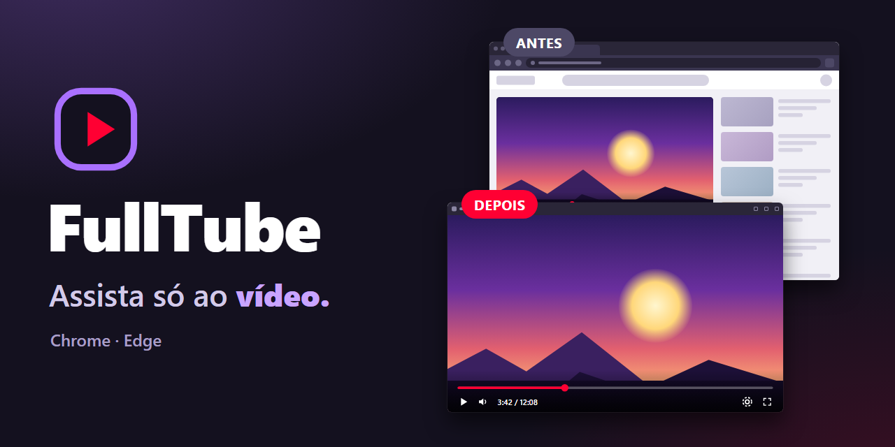
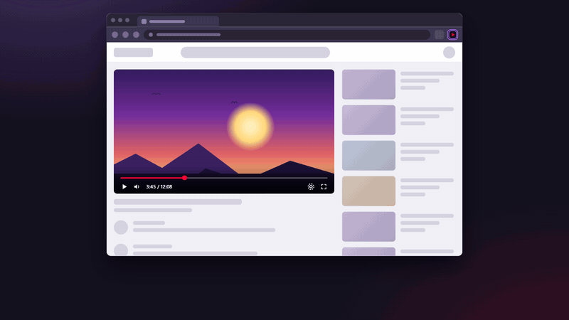
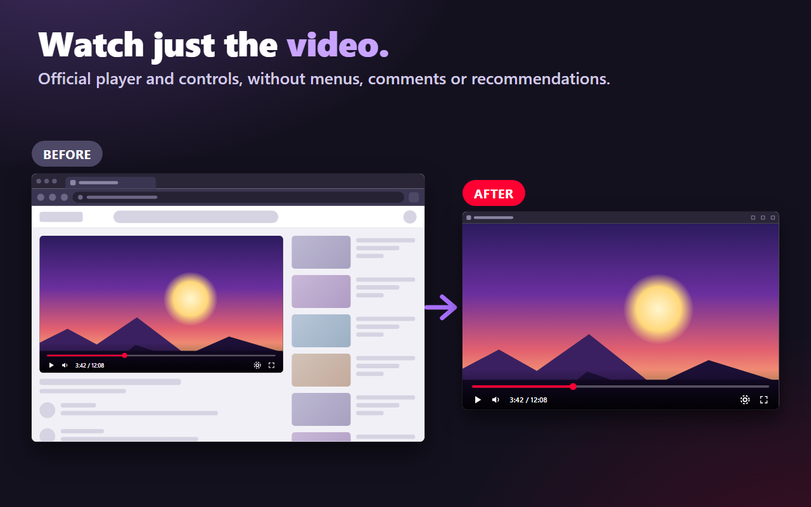
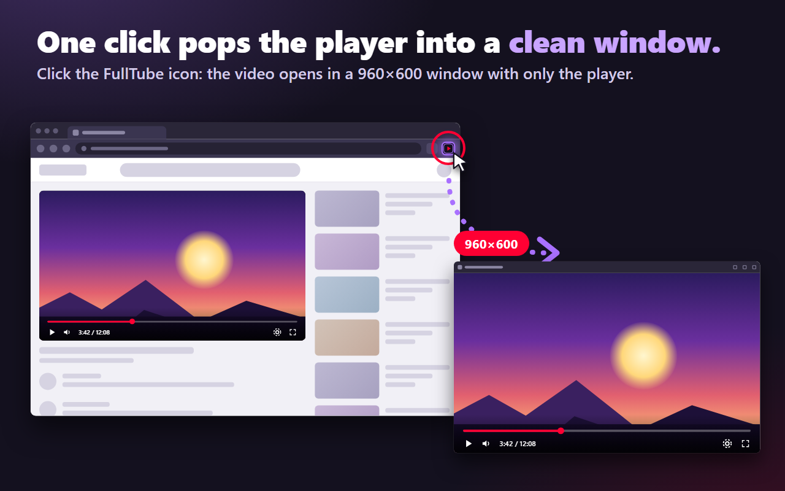
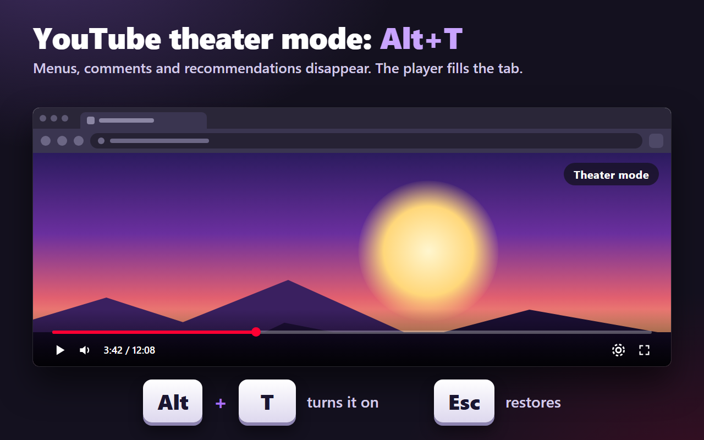

[Português](README.md) | **English**

<p align="center">
  
</p>

# FullTube — Clean Video Window & Theater Mode

**Watch videos without the rest of the page: one click pops the player into a clean window, and on YouTube theater mode fills the whole tab.**

[](https://microsoftedge.microsoft.com/addons/detail/fulltube-%E2%80%94-player-limpo/ilmcdpbkajdddfgghlbehldmaigfhkig)

[](https://fulltube.thameus.com.br)
[](LICENSE)


<p align="center">
  
</p>

Full video (25 s): [English](store-assets/video/fulltube-demo-en.mp4) · [português](store-assets/video/fulltube-demo-pt.mp4)

<p align="center">
  
  
  
</p>

The screenshots are illustrations made for this project and contain no third-party imagery.

## Features

- **A clean window in one click.** Opens the page's HTML5 player in a 960×600 window, with no menus, comments or recommendations.
- **Official player and controls.** The video is still played by the site's own page, not by a replacement player.
- **Picks up where you left off.** Restores time, volume, mute state and window position and size, per site.
- **Multiple windows.** Open as many videos as you like, each in its own window, and arrange them on screen your way.
- **Theater mode on YouTube.** `Alt+T` enlarges the player in the same tab; `Esc` restores the layout. You can change the shortcut in your browser settings.
- **English and Portuguese.** The interface follows your browser language.

## Supported sites

- YouTube (clean window and theater mode)
- Twitch
- Vimeo
- Any page with an HTML5 video

Browser-internal pages and pages without a player show an error message. The video on the source page is paused only after the new window has found the player.

## Shortcuts

| Shortcut | Where | What it does |
|---|---|---|
| `Alt+T` | YouTube tab | Turns theater mode on or off (default; can be remapped) |
| `Esc` | YouTube tab in theater mode | Leaves theater mode and restores the layout |
| `Space` | Clean window | Play or pause |
| `F` | Clean window | Video fullscreen |
| `M` | Clean window | Mute or unmute |

To change the theater mode shortcut, open `chrome://extensions/shortcuts` (Chrome) or `edge://extensions/shortcuts` (Edge).

## Privacy

FullTube does not collect or send any data. It does not download videos, extract streams, read cookies or block ads. The only thing it saves (window position and size per site) stays in the browser's local storage.

About permissions: the extension asks for access to `http` and `https` sites because, when you click the icon, it has to prepare the player in the new window on whatever site you happen to be on, and that cannot be known in advance. This access is used only to find the video and apply time, volume and layout. Nothing leaves your computer. The code is open and you can check it in this repository.

Read the [full privacy policy](https://thameus.github.io/FullTube-Player-Limpo/privacy.en.html).

## Manual installation

Use this to try a version from the repository, or if you prefer not to use a store.

1. Download or clone this repository.
2. Open `chrome://extensions` (Chrome) or `edge://extensions` (Edge).
3. Turn on **Developer mode**.
4. Click **Load unpacked**.
5. Select the `extension/` folder.

## Development

Before submitting changes to the extension, run this from the project root:

```powershell
# validate the manifest JSON
node -e "JSON.parse(require('fs').readFileSync('extension/manifest.json','utf8'))"

# check the syntax of each changed script
node --check extension/service-worker.js
node --check extension/player-mode.js

# extension tests
node extension/test-extension.js
```

Project rules are in [`AGENTS.md`](AGENTS.md) (in Portuguese). Theater mode is described in [`docs/MODO-TEATRO-YOUTUBE.md`](docs/MODO-TEATRO-YOUTUBE.md) and the publishing process in [`docs/PUBLICAR-CHROME.md`](docs/PUBLICAR-CHROME.md), both in Portuguese.

## Contributing and support

Found a bug or have a suggestion? Open an [issue](https://github.com/Thameus/FullTube-Player-Limpo/issues) with your browser, the site and the steps to reproduce it. Pull requests are welcome; run the checks above before submitting.

## License

[MIT](LICENSE) © 2026 Thameus.

## Disclaimer

FullTube is an independent project. It is not affiliated with, associated with, authorized by or endorsed by YouTube, Google, Twitch, Vimeo or Microsoft. All names mentioned belong to their respective owners and are used only to indicate compatibility.
