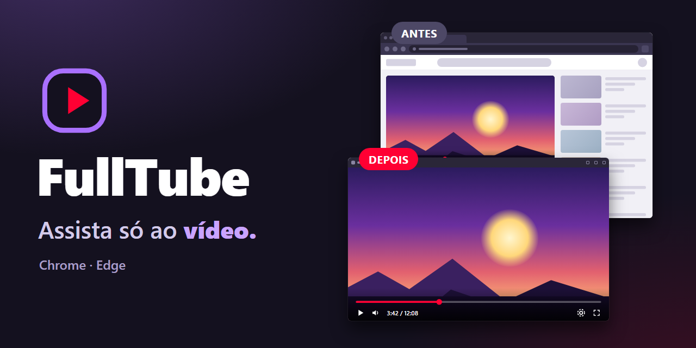
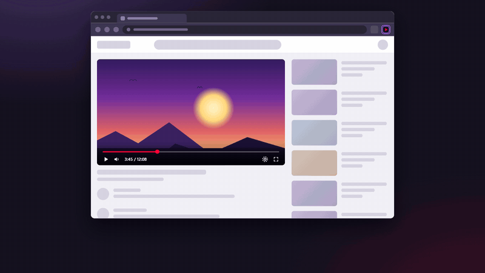
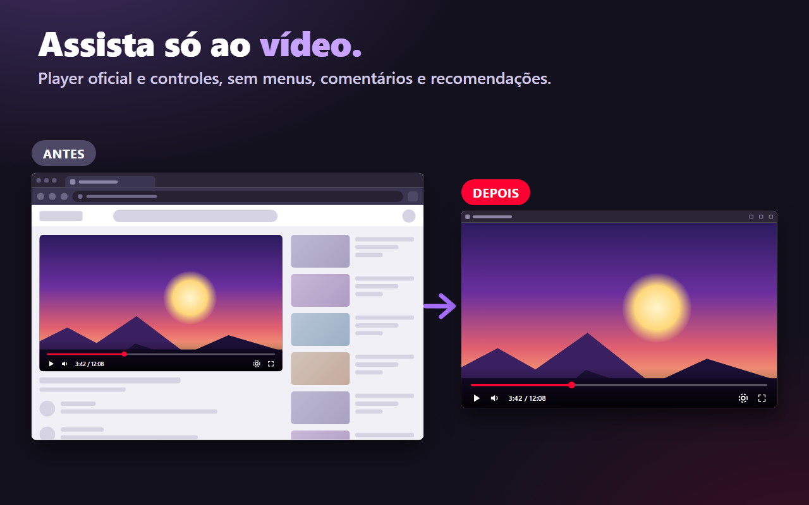
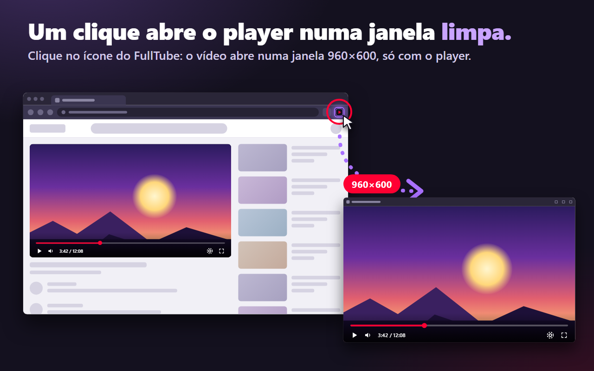
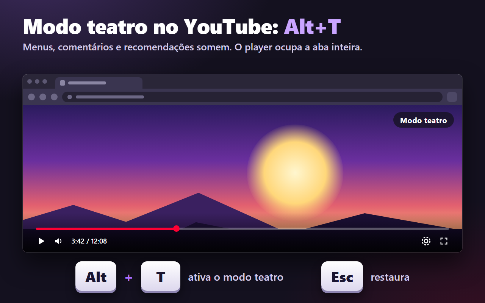

**Português** | [English](README.en.md)

<p align="center">
  
</p>

# FullTube — Janela Limpa e Modo Teatro

**Assista a vídeos sem o resto da página: um clique abre o player numa janela limpa, e no YouTube o modo teatro ocupa a aba inteira.**

[](https://microsoftedge.microsoft.com/addons/detail/fulltube-%E2%80%94-player-limpo/ilmcdpbkajdddfgghlbehldmaigfhkig)

[](https://fulltube.thameus.com.br)
[](LICENSE)


<p align="center">
  
</p>

Vídeo completo (25 s): [português](store-assets/video/fulltube-demo-pt.mp4) · [English](store-assets/video/fulltube-demo-en.mp4)

<p align="center">
  
  
  
</p>

Os screenshots são ilustrações feitas para este projeto, sem imagens de terceiros.

## Recursos

- **Janela limpa com um clique.** Abre o player HTML5 da página em uma janela de 960×600, sem menus, comentários ou recomendações.
- **Player e controles oficiais.** O vídeo continua sendo tocado pela própria página do site, não por um player substituto.
- **Lembra de onde você parou.** Restaura tempo, volume, mudo e posição/tamanho da janela, por site.
- **Várias janelas.** Abra quantos vídeos quiser, cada um em sua janela, e organize na tela como preferir.
- **Modo teatro no YouTube.** `Alt+T` amplia o player na mesma aba; `Esc` restaura o layout. O atalho pode ser alterado nas configurações do navegador.
- **Em português e inglês.** A interface segue o idioma do navegador.

## Sites compatíveis

- YouTube (janela limpa e modo teatro)
- Twitch
- Vimeo
- Qualquer página com vídeo HTML5

Páginas internas do navegador e páginas sem player exibem uma mensagem de erro. O vídeo da página de origem só é pausado depois que a janela nova encontra o player.

## Atalhos

| Atalho | Onde | O que faz |
|---|---|---|
| `Alt+T` | Aba do YouTube | Liga ou desliga o modo teatro (padrão; pode ser remapeado) |
| `Esc` | Aba do YouTube em modo teatro | Sai do modo teatro e restaura o layout |
| `Espaço` | Janela limpa | Reproduz ou pausa |
| `F` | Janela limpa | Tela cheia do vídeo |
| `M` | Janela limpa | Liga ou desliga o som |

Para mudar o atalho do modo teatro, abra `chrome://extensions/shortcuts` (Chrome) ou `edge://extensions/shortcuts` (Edge).

## Privacidade

O FullTube não coleta nem envia dados. Ele não baixa vídeos, não extrai streams, não lê cookies e não bloqueia anúncios. O que fica salvo (posição e tamanho da janela por site) permanece no armazenamento local do navegador.

Sobre as permissões: a extensão pede acesso a sites `http` e `https` porque, ao clicar no ícone, ela precisa preparar o player na janela nova em qualquer site em que você esteja, e não dá para saber de antemão quais serão. Esse acesso é usado somente para localizar o vídeo e aplicar tempo, volume e layout. Nada sai do seu computador. O código é aberto e pode ser conferido neste repositório.

Leia a [política de privacidade completa](https://thameus.github.io/FullTube-Player-Limpo/privacy.html).

## Instalação manual

Use este caminho para testar uma versão do repositório ou se preferir não usar a loja.

1. Baixe ou clone este repositório.
2. Abra `chrome://extensions` (Chrome) ou `edge://extensions` (Edge).
3. Ative o **Modo do desenvolvedor** (Developer mode).
4. Clique em **Carregar sem pacote** (Load unpacked).
5. Selecione a pasta `extension/`.

## Desenvolvimento

Antes de enviar mudanças na extensão, rode na raiz do projeto:

```powershell
# valida o JSON do manifesto
node -e "JSON.parse(require('fs').readFileSync('extension/manifest.json','utf8'))"

# checa a sintaxe de cada script alterado
node --check extension/service-worker.js
node --check extension/player-mode.js

# testes da extensão
node extension/test-extension.js
```

As regras do projeto estão em [`AGENTS.md`](AGENTS.md). O modo teatro está descrito em [`docs/MODO-TEATRO-YOUTUBE.md`](docs/MODO-TEATRO-YOUTUBE.md), e o processo de publicação em [`docs/PUBLICAR-CHROME.md`](docs/PUBLICAR-CHROME.md).

## Contribuindo e suporte

Encontrou um problema ou tem uma sugestão? Abra uma [issue](https://github.com/Thameus/FullTube-Player-Limpo/issues) informando o navegador, o site e os passos para reproduzir. Pull requests são bem-vindos; rode a validação acima antes de enviar.

## Licença

[MIT](LICENSE) © 2026 Thameus.

## Aviso

O FullTube é um projeto independente. Não é afiliado, associado, autorizado ou endossado pelo YouTube, pelo Google, pela Twitch, pelo Vimeo ou pela Microsoft. Os nomes citados pertencem aos seus respectivos donos e são usados apenas para indicar compatibilidade.
